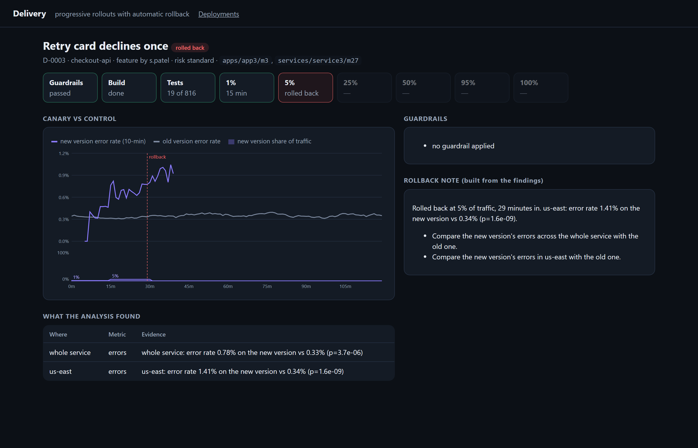
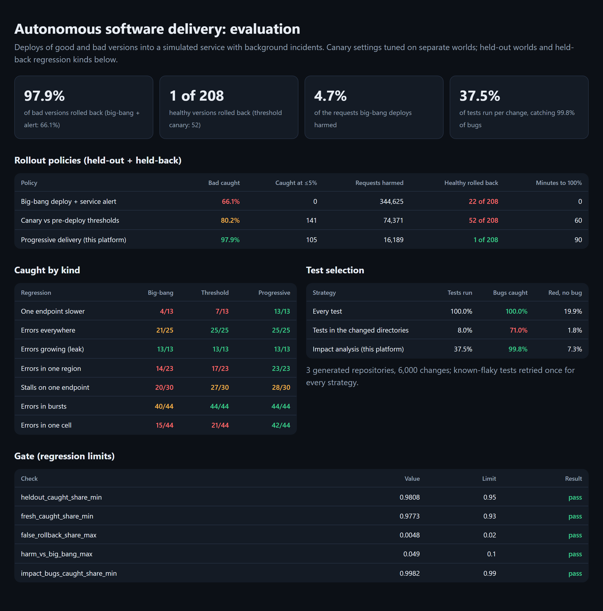
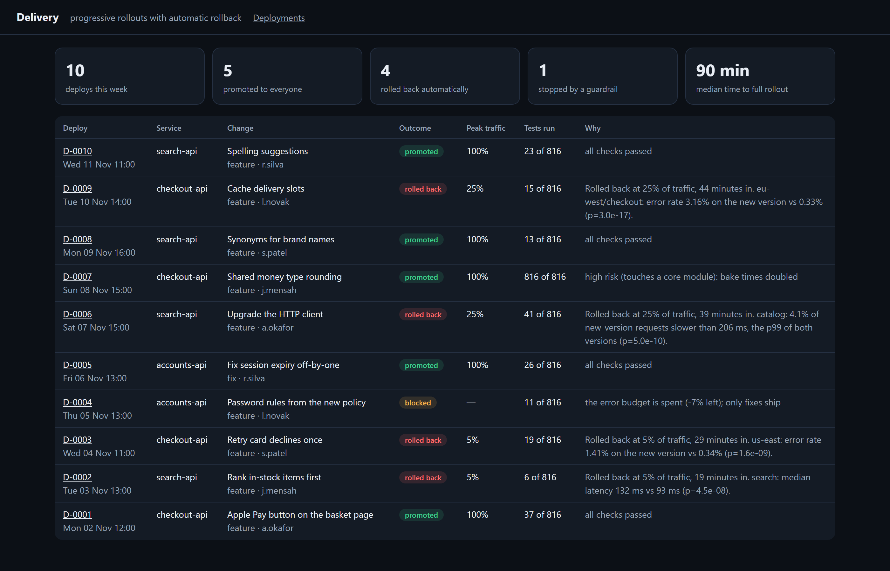

# Autonomous Software Delivery Platform

[](https://github.com/codeROCK-IZZY/autonomous-software-delivery/actions/workflows/ci.yml)


A delivery pipeline that ships changes without a person watching dashboards. Each change goes through four stages:

1. **Guardrails.** An error-budget check, change freezes, and slower rollouts with approval for risky changes.
2. **Test selection.** Only the tests the change can affect run, chosen from the dependency graph.
3. **Progressive rollout.** Traffic moves 1% → 5% → 25% → 50% → 95% → 100%. At every step a statistical comparison
   checks the new version against the old one, both serving traffic over the same minutes, for the whole service
   and for every region, endpoint and region-endpoint cell.
4. **Automatic rollback.** If the new version is worse, it is rolled back. Claude writes the rollback note, and the
   note is checked against the evidence before anyone sees it.



## Results

`deliver evaluate --gate` deploys versions into a simulated production service. The service has three regions and
four endpoints, daily traffic swings, and background incidents that hit both versions alike: a dependency failing
in one region, a traffic surge, a slow network path. Half the versions are bad, with one of seven kinds of
regression. The canary settings were tuned on **tuning worlds** only, then frozen. The numbers below come from
**held-out worlds** and from **two regression kinds held back from tuning** (errors in a single region-endpoint
cell, and failures in short bursts). [ADR 2](docs/adr/0002-simulated-service-and-honest-tuning.md) has the protocol.

| 400 deploys (held-out + held-back) | Bad versions caught | Requests harmed | Healthy versions rolled back | Minutes to 100% |
|---|---:|---:|---:|---:|
| Big-bang deploy, rolled back by the service alert | 127 of 192 (66.1%) | 344,625 | 22 of 208 | 0 |
| Canary compared with pre-deploy thresholds | 154 of 192 (80.2%) | 74,371 | 52 of 208 | 60 |
| **Progressive delivery (this platform)** | **188 of 192 (97.9%)** | **16,189** | **1 of 208** | 90 |

| Bad versions caught, by kind | Big-bang | Threshold canary | **Progressive** |
|---|---:|---:|---:|
| Errors in one region-endpoint cell (held back) | 15 of 44 | 21 of 44 | **42 of 44** |
| Errors in one region | 14 of 23 | 17 of 23 | **23 of 23** |
| One endpoint slower | 4 of 13 | 7 of 13 | **13 of 13** |
| Stalls on one endpoint | 20 of 30 | 27 of 30 | **28 of 30** |
| Errors everywhere / growing / in bursts (held back) | 74 of 82 | 82 of 82 | **82 of 82** |

| Test selection (3 repositories, 6,000 changes) | Tests run per change | Bugs caught (of 1,659) | Red with no bug |
|---|---:|---:|---:|
| Every test | 100% | 100% | 19.9% |
| Tests in the changed directories | 8.0% | 71.0% | 1.8% |
| **Impact analysis (this platform)** | **37.5%** | **99.8%** | 7.3% |

What the numbers show:

- **Compare side by side, not before and after.** The threshold canary compares the new version with the service's
  numbers from before the deploy. A dependency failure or traffic surge during the rollout looks like the new
  version's fault, so it rolled back 52 healthy versions. Comparing with the old version over the same minutes
  cancels that: 1 false rollback in 208.
- **Look where regressions live.** A bad version that breaks one region or one cell is diluted below any threshold
  in whole-service numbers. Testing each region, endpoint and cell found 42 of 44 single-cell regressions, against
  21 for the threshold canary. Adding region and endpoint groups during tuning raised the catch rate from 84% to
  99% with no extra false rollbacks.
- **The price is time and early catches.** A full rollout takes 90 minutes instead of 0 or 60. The threshold canary
  is quicker to pull the trigger: it catches 141 bad versions at 5% of traffic or less, against 105 here, at the
  cost of 52 false rollbacks.
- **Test impact analysis** runs about 38% of tests and catches 99.8% of the bugs a full run catches. The 3 it misses
  sit behind dependencies the build graph doesn't declare; the nightly full run catches those. The shortcut of
  testing only the changed directories misses 29% of bugs, because many bugs only break the modules that use the
  changed one.

Two statistics bugs found during tuning are described in [ADR 1](docs/adr/0001-side-by-side-canary-analysis.md):

- **Pooling across rollout steps.** At first, the analysis pooled data across rollout steps. Because the traffic
  split changes between steps, an incident during a later step loaded onto the new version (Simpson's paradox).
  That rolled back 21% of healthy versions.
- **A noisy tail baseline.** A tail-latency test treated a small control sample's p99 as exact, and flagged every
  healthy version at the 95% step.



## How it works

```
change ─► guardrails (error budget, freeze, risk) ─► impact analysis picks tests ─► build + tests
       ─► 1% ─► 5% ─► 25% ─► 50% ─► 95% (holdback) ─► 100%
            every 5 min: new vs old over the same minutes, whole service + 3 regions + 4 endpoints + 12 cells
            errors: exact conditional binomial · latency: Mann-Whitney U · tail: share above the pooled p99
       ─► rollback (2 min) ─► rollback note (Claude, checked against the findings, or built from them)
```

- **Canary analysis** (`canary.py`). Each test needs both evidence and a material effect: the error rate up at
  least 1.25x, the median up at least 1.10x, or at least 2% of requests stalled. Significance is shared across every
  group, test and planned look (Bonferroni on a 1% family-wise rate), so the chance of rolling back a healthy
  version stays small despite hundreds of comparisons.
- **The holdback.** The 95% step keeps 5% of traffic on the old version for 30 minutes. A full rollout otherwise
  leaves nothing to compare with.
- **Guardrails** (`policy.py`). With a 99.5% objective, a spent error budget lets only fixes through. A fast burn
  (14.4x) lets only rollbacks through. Freezes need an emergency approver. Core-module, wide or Friday-afternoon
  changes get doubled bake times and need an approver.
- **Test selection** (`selection.py`). The reverse transitive closure of the changed modules in the declared build
  graph; everything when a core module changes; known-flaky tests retried once.
- **Rollback note** (`notes.py`). Claude (`claude-opus-5-5`, low effort, refusal fallbacks) writes it through a
  strict tool, citing numbered findings. Code rejects a note that cites a finding that doesn't exist, names a
  segment no finding flagged, or states a number that isn't in the evidence. A rejected note is replaced by the
  plain note built from the findings. See [ADR 3](docs/adr/0003-rollback-notes-checked-against-evidence.md).



Decisions: [docs/adr](docs/adr). Gaps: [docs/known-limitations.md](docs/known-limitations.md).

## Run it

```bash
python -m venv .venv && . .venv/bin/activate
pip install -e ".[dev]"

deliver serve                                                    # the app with a week of demo deploys
deliver rollout --regression region_errors --region us-east     # one rollout into the simulated service
deliver rollout --policy big_bang --regression endpoint_latency --endpoint search --factor 1.5
deliver tune                                                     # the grid search on the tuning worlds
deliver evaluate --gate                                          # eval/reports/report.{md,json,html}
pytest
```

`POST /api/deploys {"service", "title", "kind", "modules", ...}` ships a change through the pipeline. In the
simulator, `regression` sets the hidden defect. Rollback notes come from Claude when `ANTHROPIC_API_KEY` is set.

## Tests and CI

Tests cover:

- simulator reproducibility, the traffic split, and regressions confined to their segments;
- healthy versions not flagged during an incident;
- each regression kind found, early rollback, and less harm than big-bang;
- slower plans, the guardrails, and test selection;
- the rollback note **through the real Anthropic SDK** with canned responses: a matching note kept, invented findings,
  segments and numbers rejected, and a refusal;
- the app and the deploy API.

CI runs ruff, `mypy --strict`, the tests on Python 3.12 and 3.13, the full evaluation gate, the container serving
the deployment history, and a gitleaks scan of the full history.

## License

MIT
